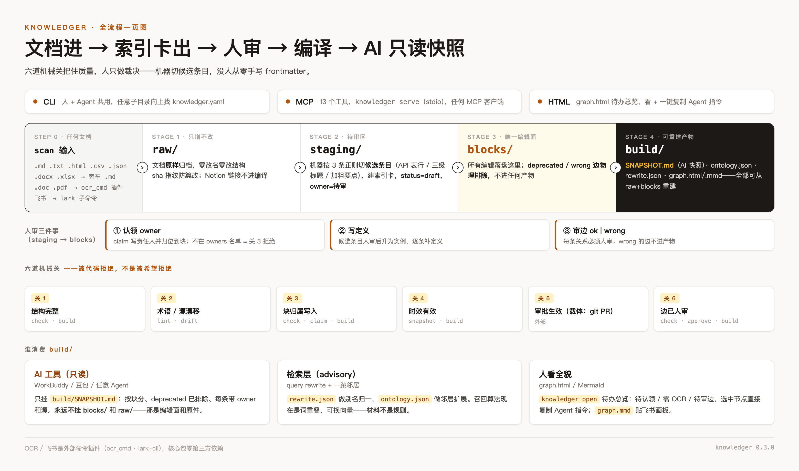

# knowledger

**文档与 AI 工具之间的治理层。** 文档原样进，机器切索引卡，人按最小单元审核（一条边、一个定义、一个归属），`knowledger build` 编译出 AI 只读、可追溯的快照。

核心零第三方依赖。Python ≥ 3.10。MIT。

```
docs ──scan──▶ raw/ ──cards──▶ staging/ ──review──▶ blocks/ ──build──▶ build/SNAPSHOT.md
      (原样)             (索引卡)       (人审 3 字段)            (AI 只读产物 + 关系图)
```

## 为什么

团队不缺知识——模块文档、API 手册、会议纪要、PRD 里全都有。缺的是两件事：

1. **AI 读到的内容没人背书**——模型张口就来的每句话无法追溯到「哪天、哪个人、确认过哪条」；
2. **人审过的内容没人维护**——审完即死档，源文档改了没人知道。

knowledger 用一条流水线把两端焊住：进不要求先建 schema，出必经真人审核，中间六道机械关挡住一切「靠自觉」。

放在当下的浪潮里看：本地知识图谱（GraphRAG / LightRAG / Graphiti 一族）让「文档 → 本地图谱 → 增强检索」成了热门路线，但 LLM 自动抽取的三元组自带幻觉，实体归一靠字符串匹配，错误关系没人兜底——图谱越大越脏，建图的 token 成本还比普通 RAG 高一个数量级。knowledger 编译出的就是一份**人审过的本地本体**（`ontology.json` + `SNAPSHOT.md`）：每条边指到一个真人和一天，别名归一表（rewrite.json）直接可用。既能单独当 AI 的知识层，也能给 GraphRAG 一族当干净的本体约束与事实来源。

## 全流程一页图



\* 旁车 .md（docx/xlsx）、OCR 插件（ocr_cmd）、飞书（lark 子命令）均已落地；OCR/飞书仍是外部命令，核心包零依赖不变。

## 亮点

- **文档进，不是 schema 先行。** 机器按 3 条正则切候选条目（API 表行、三级标题、加粗要点），人只做裁决；没人从零手写 frontmatter。
- **六道机械关，不靠约定。** 无 owner 的卡、没人审的边、过时条目混进 AI 快照——被 `check` / `build` 代码拒绝，不是被希望拒绝。
- **最小单元人审。** 一条边 `A --rel--> B`，两端定义和源文出现行并排给你 → `ok` 或 `wrong`。没人「审批一个本体」。
- **权限 = 真名。** 所有写操作 `by` 必须是该块 owner（同一张表管 CLI 和 MCP）；Agent 自报名直接被拒并附提示。prompt 注入式越权在数据模型这一层就卡死。
- **载体中立。** markdown + frontmatter + git；产物全部可重建；AI 只挂 `build/SNAPSHOT.md`，永不直接读卡片。
- **Agent 能跑完整审核动线。** 13 个 MCP 工具与 CLI 一一对应：`knowledger_status` → 列证据 → 问人 → `knowledger_approve` → `knowledger_check` → `knowledger_build`。
- **待办总览页。** `knowledger open` 打开即是：待认领 / 需 OCR / 待审边，每项附可复制的 Agent 指令。图只看不改（编辑走表单，WebVOWL 用户研究的结论）。
- **核心零第三方依赖。** 一条 `pip install` 就能跑通全闭环；LLM / OCR / 飞书全是插件点，不是依赖。

## 实测

以下数据全部来自本仓真实运行，非估算：

- **零依赖，装完就是全部**：干净 venv `pip install knowledger` 后，site-packages 里只有 knowledger 自己（0 个第三方包；MCP 支持是可选 extra）。核心 **1,948 行 Python**。
- **性能**：一份 **2,600+ 行的真实业务 Excel**（sharedStrings / 内联字符串 / 数值 / 稀疏行列混合），`zipfile + ElementTree` 抽取耗时 **59 ms**，产出 3,689 行旁车 `.md`。
- **26 个端到端测试**：六道关全链路、docx/xlsx 抽取与旁车过期重抽、坏文件不杀整轮、无主块拒绝写入。`python -m pytest tests/` 可复现。
- **真实输出**（虚构数据，从 init 到 verify 一条龙，未删减错误路径）：

  ```text
  $ knowledger init . --name 订单知识库
  $ knowledger scan docs && knowledger cards
  cards：1 张 → staging/，候选条目 6 条          # 「概述」章节被跳过
  $ knowledger claim D-3DA225F1 --by 李四
  ✓ D-3DA225F1 认领：owner 李四 @ engineering → blocks/engineering/doc/D-3DA225F1.md
  $ knowledger check                            # 未经人审的边被关 6 拦下
      关6 边 D-3DA225F1 --contains--> BF-REFUND-01 未经人审（需 review.verdict: ok|wrong）
  $ knowledger approve D-3DA225F1 contains BF-REFUND-01 ok --by 李四 "归属正确"
  ✓ D-3DA225F1 --contains--> BF-REFUND-01  ok
  $ knowledger check && knowledger build && knowledger verify
  3 条实例，0 条不通过
  build：3 张卡 → 1 条边 → 9 个 rewrite 词；0 个问题
  三道关：0 个问题
  ```

  编译出的 AI 快照（节选，真实）：

  ```markdown
  ## engineering（2）

  ### Feature BF-REFUND-01 · 退款规则
  owner 李四 · status active

  ### Doc D-3DA225F1 · orders-api.md
  owner 李四 · status active · 源 `raw/docs/orders-api.md`
  - `POST /orders` 创建订单
  - 仅退款
  ```

## 与同类项目的差异

公开项目大致三簇（截至 2026-11 扫描）：**抠事实**（myKG、trikedb）、**审标注**（AnNER、Label Studio 族）、**喂 AI**（llms.txt 族）；同期的本地图谱热（LightRAG / GraphRAG / Graphiti）解决的是「文档→图」的抽取，与 knowledger 的「图→可信」是上下游而非同类。knowledger 是少数把三段焊成一条带机械关流水线的：进不需要 LLM，出必有真人背书。

| 维度 | LLM 抽取管线（LightRAG / GraphRAG 等本地图谱的上游） | 标注/复审工具 | AI 可读导出 | knowledger |
|---|---|---|---|---|
| 信任模型 | 模型置信分 0–1 | 标注状态+溯源 | 无治理 | 每条边指到一个真人和一天（ok/wrong + review_by/at） |
| 审核 | schema 级一次性门 / PR-diff 粒度 | 实体在文本里，非关系图 | 无 | 逐条边带两端定义+源文行的持续流程 |
| 权限 | 无 owners 概念 | 角色制（部署重） | 无 | owners 表 = 写权 = 审批权，CLI/MCP 同表 |
| 依赖 | 必须有 LLM API key 等 | Web 服务+数据库 | 站点插件 | 核心零依赖，LLM 是可插加速器 |
| 漂移治理 | schema 用途漂移检测 | 无 | 无 | sha 指纹 drift：源文档变了 → 卡自动待重审 |
| AI 侧接口 | MCP 只读 / Obsidian vault | — | llms.txt / MCP | SNAPSHOT + recall + 13 MCP 工具（含 owner 门禁的写） |

三句话版本：

- **信任**：别的项目给 AI 喂「更多上下文」，knowledger 喂「有人名背书的最小事实集」——AI 说错的每句话，可以追溯到哪天哪个人审的哪条边。本地图谱族自动抽的三元组正好相反：量更大，但没人为单条边负责。
- **成本**：不需要 GPU、API key、向量库就能跑通全闭环；本地图谱族建一次图的 token 账单，往往比整个知识库的维护成本都高。
- **诚实边界**：下面「不做的事」一节本身就是差异化——竞品的过度承诺区，正是 knowledger 不做的地方。knowledger 不自动建图，也不假装能替代 GraphRAG 的多跳检索；它把「图上的每一个节点和边是否可信」这件事做成了流水线。

## 安装

```bash
pip install -e .          # from a checkout; PyPI publishing not done yet
knowledger --version
```

换机部署 + 上手指引（怎么装、日常动线、FAQ）：[`docs/快速上手.md`](docs/快速上手.md)

## 10 分钟上手

```bash
knowledger init my-kb && cd my-kb
$EDITOR knowledger.yaml       # 唯一配置：块、owners、类型、关系词表
knowledger selftest           # init 自带的故意违规样例必须被拦

knowledger scan ~/docs/api ~/docs/prd          # 文档 → raw/，原样不动
knowledger cards                               # raw/ → 每份一张索引卡 → staging/
knowledger review cards                        # 看按块分布，挑你的

knowledger claim D-XX --by 李四                 # 认领：写 owner、归位 blocks/<块>/
knowledger check              # 关1 结构 · 关3 归属 · 关6 边已审
knowledger review edges       # 每条边：两端 + 源文行 → 审
knowledger approve D-XX contains BF-01 ok --by zhangsan "归属正确"
knowledger build              # → build/ontology.json  SNAPSHOT.md  rewrite.json  graph.*
knowledger graph              # Mermaid 文本——贴飞书 / Notion / Obsidian
knowledger open               # 待办总览：待认领 / 需 OCR / 待审边
knowledger recall "怎么取消订单"   # 给 LLM 的材料包，不是规则
knowledger drift              # 哪些源文档变了 → 待重审
knowledger lark https://xx.feishu.cn/wiki/XXX   # 飞书文档经 lark-cli 拉 markdown 进 raw/feishu/
```

## 审核动线（Agent 视角，走 MCP）

`knowledger_status`（谁拥有哪个块）→ `knowledger_review_edges`（待审边带两端定义和源文行）→ *Agent 念给 owner 听，owner 说 对 / 错 / 错在哪端* → `knowledger_approve(by=<owner>)` → `knowledger_check` 必须过 → `knowledger_build`。Agent 自编一个名字，会被拒并收到提示。owner 的那一个字是全流程唯一没有工具的步骤——故意的。

## 一张索引卡长什么样

```markdown
---
id: D-5BEC93DE
type: Doc
name: 02-流向.md
owner: 李四              ← 人填
block: engineering       ← 机器推断（路径 / 关键词计分），人纠正
status: active
version: 1
sources:
  - doc: D-5BEC93DE
    version: 1
relates_to:
  - rel: contains
    from: BF-001
    review: ok           ← 关6：active 卡的每条边都要有这个
    review_by: 李四
    review_at: 2026-11-24T08:31:21
---
## 来源
`raw/engineering/02-流向.md`　sha `5bec93de`
## 机器推断
- 归属块：**engineering**
## 候选条目（25 条）
1. § 流向清洗
2. `POST /start` 启动流向清洗任务    ← 一行 = 一个候选功能
## 定义
（人写，一句话）
```

## 六道关

| 关 | 拦什么 | 在哪执行 |
|---|---|---|
| 关1 结构 | 缺必填字段；sources 非 `[{doc, version}]`；关系名不在白名单 | `check`、`build` |
| 关2 术语/源漂移 | 实例名不在术语表；raw/ 源 sha 变化（报告） | `lint`、`drift` |
| 关3 块归属写入 | 写入者不在该块 `owners` | `check`、`add`、`claim`、`build` |
| 关4 时效 | deprecated 条目混进 AI 快照 | `snapshot`、`build` |
| 关5 审批 | 在载体上——git PR / 分支保护，不在这个包里 | — |
| 关6 边已人审 | active 卡上任何边缺 `review: ok\|wrong` | `check`、`build`、`approve` |

## 配置 = 一个文件

`knowledger.yaml`（JSON 兼容的 YAML 子集，不引 PyYAML）：

```yaml
name: 我的知识库
blocks:
  product:     { owners: [张三], hints: [需求, 功能, PRD], default_type: Feature }
  engineering: { owners: [李四], hints: [API, 路由, Service],  default_type: Module }
  marketing:   { owners: null,   hints: [文章, 关键字],        default_type: Article }
types:
  Doc:     { block: product,     required: [name, owner, status, sources, version] }
  Feature: { block: product,     required: [name, owner, status, sources] }
  Module:  { block: engineering, required: [name, owner, status, sources] }
  Article: { block: marketing,   required: [title, owner, status, sources, reviewer] }
relations: [contains, applies_to, verified_by, cites, supersedes]
section_noise: [概述, 快速配置, 完整示例]   # 文档章节标题，不是业务对象
status_enum: [active, deprecated, draft]
common_required: [id, type, name, owner, block, status, sources]
```

`owners: null` = 无人拥有 → 关 3 拒绝所有人。哪天有人认领，填上名字即可，别的都不用动。

## 支持的格式

| 输入 | 抽取？ | 方式 |
|---|---|---|
| .md .txt .html .csv .json | ✅ 全文 | 直接 |
| .docx .xlsx | ✅ 全文 | 零依赖（zipfile + xml），旁车 `.md` 缓存，可手工修正 |
| .doc .pdf | 仅建卡，正文空 | 配 `ocr_cmd` 插件点即自动 OCR（POSIX；参考实现 plugins/ocr_deepseek.py，从仓库复制到本机用，不随 pip 安装） |
| 飞书文档 | ✅ markdown | `knowledger lark <url>`（外部 lark-cli，不进核心包） |
| Notion | ❌ 不做 | — |
| 图片 / 音频 / 视频 | ❌ 拒绝 | — |

## 方法 vs 实现

**方法（不要改）：** 文档优先、最小单元审核、六道机械关、recall 给材料不给规则。

**实现（撑不住了就换）：**
- 候选切分 = 3 条正则。纯散文切不出东西——故意的，那部分人自己读。
- 召回 = 中文 bigram 重叠 + 别名改写 + 一跳邻居。中文够用；有了基线再换向量。
- `graph.html` 布局 = 极简力导向，≤80 节点。再多用 Mermaid 或外部工具。

## 不做的事

- 不做拖线连边的图编辑器。审核者是领域专家不是本体工程师，拖线产生的方向错误比表单多。
- 核心包不带 OCR、飞书抓取、向量库——每个都要凭证或外部命令。插件点已留（`ocr_cmd` / `knowledger lark` 走外部 lark-cli）；Notion 明确不做。
- 不做实时协作。git 冲突就是协作。
- 不做 OWL 推理机。九种关系类型，人审比配推理机快。

## 设计依据

最小审核单元（边 / 定义 / 树拆成三种动作）和「图看、表改」的分工，依据：Palantir Ontology Proposal 模型（按资源拆任务、逐条批、留变更记录）与 WebVOWL vs Protégé 用户研究（节点连线图帮助**非专家**更快更准地理解，专家无差别）。差异对照基于 2026-11-24 对 trikedb / myKG / AnNER / llms.txt 族的公开扫描（含各项目自述的局限，如 trikedb 基准为检索+grounding 组合效果、非官方 WebQSP 指标）。

## License

MIT
